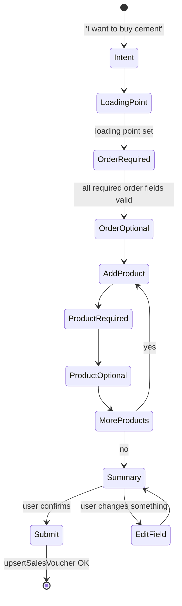

# Karibu Order Assistant — Chatbot Specification

> **Audience:** an LLM agent / chatbot that guides a **customer** (aemma-frontend user) through Karibu.
> **Scope:** (A) Normal order, (B) Cancel order, (C) Amend order, (D) Make payment.
> **Source of truth:** behaviour mirrors `aemma-frontend`. The backend always re-validates; the bot must never assume success until a mutation returns.
> Related: [order-process.md](order-process.md) (field/config reference for all order modes).

---

## 0. Agent operating rules

1. **Configuration drives the conversation.** Before asking for any field, check the flag that enables it (see §1). Never ask for a field the user's location/company has not enabled.
2. **Ask required fields first, then offer optional ones as a single yes/no.** Never block on optional fields.
3. **Auto-select when there is only one choice** (loading point, delivery type, payment mode) and *tell* the user what was selected.
4. **Validate each answer immediately** (length, min/max, duplicates) and re-ask only the failing field.
5. **Always summarise and get an explicit "yes" before any mutation.**
6. **An order is a quotation request.** `upsertSalesVoucher` creates a sales voucher; the price (`orderQuote`) is produced by the backend and may be `null` at creation. Say "your quotation has been requested" — do not invent a price.
7. **Never expose IDs, internal statuses or error stack traces** to the user. Map status ids to the labels in §5.
8. **Unit wording:** products with `unitOfMeasure = Kg` are counted in **bags**; otherwise in **tons**.

### Context the bot must load at session start

| Key | Source |
| --- | --- |
| `user.companyId`, `user.customerId`, `user.location.*`, `user.location.company.*`, `user.company.allowOrderCancellation` | Redux `state.auth.user` (`getUserByEmail` in `src/store/authSlice.ts`) |
| Role permission `canCreateOrder` | user permissions service |
| Country id | `user.location.company.countryId` |

If `canCreateOrder` is false → reply that the account cannot place orders and stop flow A.

---

## 1. Configuration flags (slot gating)

`loc` = `user.location`, `co` = `user.location.company`.

| Flag | Effect on the conversation |
| --- | --- |
| `co.allowDepotSelection` | Offer "buy from depot?" — switches loading points from plants to depots |
| `loc.allowDeliveryTypeSelection` | Ask delivery type (EXW / DELIVERED) |
| `loc.allowDeliveryTypeSelectionForProduct` | Ask delivery type **per product** instead of per order; destination also moves to per product |
| `loc.defaultDeliveryType` | Pre-select delivery type (DELIVERED ⇒ transport inclusive) |
| `loc.requireDestinationSelectionForExworks` | Show destination for EXW (optional for EXW) |
| `loc.useLocalPoNumber` | Ask Local PO number (**required** when shown) |
| `loc.useFileUpload` | Offer document upload (optional) |
| `loc.requireFileUpload` | Document upload **and** Local PO become **required** |
| `loc.useDescription` / `loc.useComments` / `loc.useDeliveryContact` | Optional order-level text fields |
| `loc.allowOrderReference` | Optional per-product order reference |
| `loc.truckSelectionAllowed` (EXW) / `loc.allowTruckSelectionForDelivered` (DELIVERED) | Offer truck selection |
| `loc.truckSelectionFromMasterAllowed` | Truck search source: master list vs customer trucks |
| `loc.allowDriverSelection` (EXW) / `loc.allowDriverSelectionForDelivered` (DELIVERED) | Offer driver selection |
| `co.allowNewDriverAndVehicle` | Allow "add a new truck/driver" when not found |
| `loc.useDeliveredOrderManagement` | Offer delivery date for DELIVERED items; enables delivery-date amendment |
| `loc.useConfirmQuotation` | User must **confirm the quotation** before paying |
| `co.customerTranscription` | Payment requires bank/transcription details |
| `user.company.allowOrderCancellation` | Enables cancellation **requests** for generated sales orders |
| `co.sunBusinessUnit = cimbenin` | Destination always required |

---

## 2. Flow A — Create a normal order

### 2.1 State machine



### 2.2 Step gates (what must be true to proceed)

| # | Step | Required to proceed | Blocks with |
| --- | --- | --- | --- |
| 1 | Intent | `canCreateOrder` | "Your account can't create orders." |
| 2 | Loading point | One plant (or depot) selected. 1 option ⇒ auto-select; >1 ⇒ user picks | — |
| 3 | Order-level required | Delivery type resolved (asked or default) · Destination if DELIVERED **or** cimbenin (not when delivery type is per product) · Local PO if `useLocalPoNumber` or `requireFileUpload` (≤27 chars, not already used) · ≥1 document if `requireFileUpload` (max 3, PDF/image) | Re-ask failing field |
| 4 | Order-level optional | None required. Description ≤50 chars | — |
| 5 | Product required | Product available at loading point · Quantity per sales order within product min/max · Number of sales orders (trucks) ≥1 · Delivery type per product if `allowDeliveryTypeSelectionForProduct` · Destination if the item is DELIVERED | Re-ask failing field |
| 6 | Product optional | Order reference ≤26 chars, not used before, not duplicated in cart · Truck · Driver · Delivery date ≥ today + `minDeliveryDays` | — |
| 7 | Cart | ≥1 product, every item valid, no reference errors, no DELIVERED item without destination | List the invalid items |
| 8 | Summary | Explicit user confirmation | — |
| 9 | Submit | `upsertSalesVoucher` returns `salesVoucher.id` | "Unable to create quotation, please try again." |

### 2.3 Slots

**Order-level**

| Slot | Required? | Shown when | Validation | Maps to |
| --- | --- | --- | --- | --- |
| `loadingPoint` | Yes | Always | From `GetPlantLocations` / `GetDepotLocations` | `sourceLocationId` |
| `deliveryType` | Yes (auto if not selectable) | `allowDeliveryTypeSelection && !allowDeliveryTypeSelectionForProduct` | `EXW` \| `DELIVERED` | `isDeliveryInclusive` |
| `destination` | DELIVERED or cimbenin | DELIVERED, or `requireDestinationSelectionForExworks`; not when per-product delivery type | From destination search | item `destinationId` |
| `localPurchaseOrder` | Yes when shown | `useLocalPoNumber \|\| requireFileUpload` | ≤27 chars, `checkIfLocalPOExists` = false | `localPurchaseOrder` |
| `documents` | When `requireFileUpload` | `useFileUpload \|\| requireFileUpload` | ≤3 files, PDF/image | `documents` |
| `description` | No | `useDescription` | ≤50 chars | `description` |
| `comments` | No | `useComments` | — | `comments` |
| `deliveryContact` | No | `useDeliveryContact` | — | `deliveryContact` |

**Per product (cart item)**

| Slot | Required? | Shown when | Validation | Maps to |
| --- | --- | --- | --- | --- |
| `product` | Yes | Always | From `getProductLocation(locationId)`; skip products whose constraint `maxProductQuantity = 0` | `productId` |
| `quantityPerSalesOrder` | Yes | Always | `minProductQuantity ≤ q ≤ maxProductQuantity` (`getProductContraints`) | `quantity` |
| `numberOfSalesOrders` | Yes | Always | Integer ≥1 | `trucksCount` |
| `itemDeliveryType` | Yes when shown | `allowDeliveryTypeSelection && allowDeliveryTypeSelectionForProduct` | `EXW` \| `DELIVERED` | `isDeliveryInclusive` |
| `itemDestination` | If item DELIVERED | Item DELIVERED | From destination search | `destinationId` |
| `orderReference` | No | `allowOrderReference` | ≤26 chars, `checkIfOrderReferenceExists` = false, unique in cart | `customerRef` |
| `truck` | No | EXW+`truckSelectionAllowed` or DELIVERED+`allowTruckSelectionForDelivered` | Search; or new truck if `allowNewDriverAndVehicle` | `vehicleId` / `vehicleRequestInput` |
| `driver` | No | EXW+`allowDriverSelection` or DELIVERED+`allowDriverSelectionForDelivered` | Search; or new driver if `allowNewDriverAndVehicle` | `driverId` / `driverRequestInput` |
| `deliveryDate` | No | DELIVERED + `useDeliveredOrderManagement` | ≥ today + `minDeliveryDays` | `deliveryDate` |

New truck: `{ licensePlate (req), vehicleTypeId?, transporterCode? }`.
New driver: `{ firstName, lastName, licenseNo, licenseExpDate (all req), transporterCode? }`.

Total quantity per item = `quantityPerSalesOrder × numberOfSalesOrders` (bags or tons).

### 2.4 Chat pattern

`[...]` = bot-internal action, `{...}` = only when the flag/condition holds.

```text
USER: I want to buy cement.
BOT:  [check canCreateOrder; load plants (and depots if allowDepotSelection)]
      {>1 loading point}
      Sure. Which loading point would you like to collect from?
        1. Tema Plant   2. Takoradi Plant   3. Kumasi Depot
      {exactly 1}
      Your order will be loaded from Tema Plant.

USER: 1
BOT:  {allowDeliveryTypeSelection && !perProduct}
      Should we deliver it to you (DELIVERED) or will you collect it (EXW)?
      {not selectable} Delivery type is set to <defaultDeliveryType>.

USER: Delivered
BOT:  {DELIVERED or cimbenin} Where should it be delivered? Type the destination name.
USER: Accra Central
BOT:  [search destinations] I found: 1. Accra Central Site  2. Accra Central Warehouse. Which one?
USER: 1
BOT:  {useLocalPoNumber || requireFileUpload}
      Please give me your Local Purchase Order number (max 27 characters).
USER: LPO-2026-0042
BOT:  [checkIfLocalPOExists] {used} That LPO number has already been used. Please give another.
      {requireFileUpload} Please upload your LPO document (PDF or image, up to 3 files).
USER: <uploads lpo.pdf>

BOT:  Required order details are complete.
      Would you like to add any optional details? {list only enabled}
        • Description (max 50 chars)  • Comment  • Delivery contact  {useFileUpload} • Documents
USER: Yes, comment: "Call before arrival"
BOT:  Noted. Anything else optional? (yes/no)
USER: No

BOT:  [getProductLocation + getProductContraints]
      Which product would you like?
        1. CEM II 42.5R (bags)   2. CEM I 52.5N (tons)
USER: 1
BOT:  {perProduct delivery type} Delivered or EXW for this product?
      How many bags per sales order? (min 600, max 800)
USER: 700
BOT:  How many sales orders (trucks) of 700 bags?
USER: 2
BOT:  {item DELIVERED and no destination yet} Where should this product be delivered?

BOT:  Optional for this product — would you like to add any of these? {list only enabled}
        • Order reference  • Truck  • Driver  • Delivery date (earliest: 24-10-2026)
USER: Order reference ABC123 and delivery date 25 Oct.
BOT:  [checkIfOrderReferenceExists] Added.
      {truck not found && allowNewDriverAndVehicle} I couldn't find that truck. Should I request it as a new truck? (licence plate, vehicle type)

BOT:  Would you like to add another product? (yes/no)
USER: No

BOT:  Here is your order:
        Loading point: Tema Plant | Delivery: DELIVERED → Accra Central Site
        LPO: LPO-2026-0042 (1 document) | Comment: Call before arrival
        1. CEM II 42.5R — 700 bags × 2 sales orders = 1,400 bags
           Ref ABC123 | Delivery 25-10-2026
      Total: 1,400 bags across 2 sales orders.
      Prices are provided in the quotation after you submit.
      Shall I submit this quotation request? (yes / change something / cancel)
USER: Yes
BOT:  [upsertSalesVoucher]
      Your quotation request SV-000123 has been submitted.
      {orderQuote != null} Quoted total: GHS 123,450.00.
      {orderQuote == null} I'll let you know when the quotation is ready; you can then {useConfirmQuotation ? confirm it and } pay.
```

### 2.5 After submission (quotation → payment)

| Voucher state | What the user can do |
| --- | --- |
| `Quotation` (1) **without** `orderQuote` | Wait. Cancel (delete) allowed. |
| `Quotation` (1) / `QuotationGenerated` (10) **with** `orderQuote` and `useConfirmQuotation` | **Confirm quotation** (`ConfirmQuotation`), then pay. Cancel allowed. |
| Same, without `useConfirmQuotation` | **Make payment** (Flow D). Cancel allowed. |
| `PaymentSubmitted` (8), `PaymentConfirmed` (3), `PartiallyConfirmed` (13) | Resubmit payment (disabled once first approval passed, unless last payment rejected). |

---

## 3. Flow B — Cancel an order

There are **two** cancellation mechanisms depending on how far the order has progressed.

### 3.1 Decision table

| Case | Conditions | User inputs | Mutation | Result |
| --- | --- | --- | --- | --- |
| **B1. Delete voucher** (before sales orders exist) | Status is `Pending` (12), `Quotation` (1), `QuotationGenerated` (10) or `PaymentSubmitted` (8) **and NOT** (`useDeliveredOrderManagement` ∧ any DELIVERED item ∧ status ≠ `Pending`) | Confirmation only | `deleteSalesVoucher` | Voucher voided immediately |
| **B2. Request whole-order cancellation** | `allowOrderCancellation` = true **and** status `SOGenerated` (9) | Optional reason (≤500 chars) | `requestSalesVoucherCancellation` (no `itemCancellations`) | Status → `CancellationRequested` (14) — pending approval |
| **B3. Request single sales-order cancellation** | `allowOrderCancellation` = true **and** voucher status `SOGenerated` (9) or `CancellationRequested` (14) with an uncancelled item **and** the item's sales-order status is Unconfirmed (10) or Confirmed (20) **and** no cancel already pending for that item | Pick the sales order, then optional reason (≤500 chars) | `requestSalesVoucherCancellation` with one `itemCancellations` entry | That sales order pending approval |

If none match → "This order can no longer be cancelled from the app. Please contact your sales representative."

### 3.2 Chat pattern

```text
USER: Cancel order SV-000123.
BOT:  [getSalesVoucherById; evaluate §3.1]
      {B1} SV-000123 is still a quotation. Deleting it cannot be undone. Delete it? (yes/no)
      {B2/B3} SV-000123 has 2 sales orders: SO-9001 (Confirmed), SO-9002 (Unconfirmed).
              Cancel the whole order or a specific sales order?
USER: Only SO-9002.
BOT:  Are you sure you want to request cancellation of SO-9002? (yes/no)
USER: Yes
BOT:  Would you like to give a reason? (optional, max 500 characters)
USER: Customer site not ready.
BOT:  [requestSalesVoucherCancellation]
      Your cancellation request for SO-9002 was submitted and is pending approval.
```

---

## 4. Flow C — Amend an order

### 4.1 What is available

| Amendment | Status in aemma-frontend | Conditions | Mutation |
| --- | --- | --- | --- |
| **C1. Change / clear delivery date** of a sales order | Implemented | `useDeliveredOrderManagement` = true and the item is DELIVERED. If voucher status ≠ `Pending` the change needs approval (shows "pending" until approved). New date ≥ today + `minDeliveryDays` | `SetDeliveryDate` |
| **C2. Amend sales order fields** (quantity, product, destination, delivery type, loading point, order reference, truck/transporter, driver) | **API only — not wired in aemma-frontend.** | Company `allowOrderAmendment` = true **and** the specific field enabled in company `amendableFields` | `amendSalesOrder` |

For C2 the bot must only offer fields where `company.amendableFields.<field>` is `true`:

| `amendableFields` key | `AmendSalesOrderInput` field |
| --- | --- |
| `quantity` | `quantity` |
| `product` | `productId` |
| `destination` | `destinationId` |
| `deliveryType` | `isDeliveryInclusive` |
| `loadingPoint` | `sourceLocationId` |
| `orderReference` | `customerRef` |
| `truck` | `vehicleId` |
| `transporter` | `supplierId` |
| `driver` | `driverId` |

Apply the same validations as order creation (min/max quantity, reference length/uniqueness, destination required for DELIVERED, delivery date ≥ min days).

> **Open questions (confirm with backend before enabling C2):** which voucher / sales-order statuses allow amendment, and whether `allowOrderAmendment` / `amendableFields` are already returned on the auth user (they are in the schema on `Company` but not selected by the frontend's `getUserByEmail` query).

### 4.2 Chat pattern

```text
USER: I want to change the delivery date for SO-9001.
BOT:  [getSalesVoucherById; check C1]
      Current delivery date is 25-10-2026. What new date would you like? (earliest 24-10-2026, or say "clear")
USER: 28 October
BOT:  Change SO-9001 delivery date to 28-10-2026? (yes/no)
USER: Yes
BOT:  [SetDeliveryDate]
      {status ≠ Pending} Your change was submitted and is awaiting approval.
      {status = Pending} Delivery date updated.

USER: Change quantity on SO-9002 to 500 bags.
BOT:  {C2 enabled && amendableFields.quantity}
        Allowed range is 600–800 bags. Please give a value in that range.
      {not enabled} Quantity changes aren't available for your account. Would you like to cancel and re-order instead?
```

---

## 5. Flow D — Make a payment

### 5.1 Step gates

| # | Step | Required to proceed |
| --- | --- | --- |
| 1 | Select order | Voucher has `orderQuote` and status `Quotation` (1) / `QuotationGenerated` (10); if `useConfirmQuotation`, quotation already confirmed. Resubmit allowed for `PaymentSubmitted` / `PaymentConfirmed` / `PartiallyConfirmed` unless blocked (§2.5). |
| 2 | Payment type | **E-payment** (`getActiveEPaymentsModeByCompany`, `paymentModeTypeId = 1`, e.g. Mobile Money) or **Other/manual** (`getActiveManualPaymentsModeByCompany`, `paymentModeTypeId = 2`). Only active modes (`paymentModeStatusId = 1`). |
| 3 | Payment mode | One mode chosen → determines `documentTypeId` (table 5.2). |
| 4 | Mode inputs | All required inputs for that document type present (table 5.2). |
| 5 | Checks | Available Balance: `orderQuote ≤ available` (selected reference's `remainingBalance` when `customerTranscription`, else `customerAvailableCredit`). Reference ≤30 chars. Bank reference not already used (`GetCheckIfBankReferenceIsReused`). |
| 6 | Confirm | User confirms amount + mode. |
| 7 | Submit | `upsertPayment` returns `payment.id`. E-payment: open `ePaymentCheckOutUrl`, then poll `getEPaymentTransactionStatus`. |

### 5.2 Required inputs per manual document type

`documentTypeId` values: 1 EPayment · 2 CashDepositSlip · 3 ChequeDepositSlip · 4 Cheque · 5 HaulageClaimCertificate · 6 CreditOrderCertificate · 7 BankTransferNote · 8 EndorsedDraft · 9 AvailableBalance.

**When `customerTranscription` = true**

| Document type | Required |
| --- | --- |
| Cash / Cheque deposit slip (2, 3) | bank, depositor name, depositor contact, document reference, document date, amount, ≥1 document |
| Cheque (4) | bank, document reference, document date, amount, ≥1 document |
| Bank transfer note (7) | bank, document date, amount, ≥1 document |
| Haulage claim / Credit order certificate (5, 6) | document reference, amount, ≥1 document |
| Endorsed draft (8) | ≥1 document |
| Available balance (9) | available-balance reference (≤30 chars); amount = `orderQuote` (not asked) |

Bank branch is optional. **When `customerTranscription` = false:** Available balance needs nothing extra; every other type needs ≥1 document.

**E-payment:** amount is required; user completes payment on the provider page.

### 5.3 Payment statuses

`1 Pending · 2 Approved · 3 Rejected · 4 Cancelled · 5 Closed · 6 TranscriptionRequired · 7 TreasurerApprovalRequired · 8 FinalApprovalRequired · 9 SalesOfficerApprovalRequired`

### 5.4 Chat pattern

```text
USER: I want to pay for SV-000123.
BOT:  [getSalesVoucherById; check §5.1 step 1]
      {useConfirmQuotation && not confirmed}
        The quotation for SV-000123 is GHS 123,450.00. Do you accept it? (yes/no)
      USER: Yes  →  [ConfirmQuotation] Quotation confirmed.
      How would you like to pay? 1. Mobile Money  2. Other payment methods
USER: 2
BOT:  [getActiveManualPaymentsModeByCompany]
      Choose a method: 1. Cash deposit slip  2. Cheque  3. Bank transfer note  4. Available balance
USER: 1
BOT:  {customerTranscription} Which bank did you deposit at?
USER: Ecobank
BOT:  [getCountryBanks] Branch? (optional)
      Depositor name? → Depositor contact? → Deposit slip reference? → Deposit date?
      [GetCheckIfBankReferenceIsReused] {reused} That reference has already been used. Please check and re-enter.
      Amount paid?
      Please upload the deposit slip.
USER: <uploads slip.jpg>
BOT:  Confirm payment:
        SV-000123 | Cash deposit slip | Ecobank | Ref DS-7781 | 20-10-2026 | GHS 123,450.00
      Submit? (yes/no)
USER: Yes
BOT:  [upsertPayment]
      Payment submitted (ref PAY-55821). Status: pending approval.

--- Available balance variant ---
BOT:  [getCustomerAvailableBalance] {orderQuote > available}
      Your available balance (GHS 100,000.00) is less than the quotation (GHS 123,450.00). Please choose another method.

--- E-payment variant ---
BOT:  Amount to pay? → [upsertPayment with redirectUrl]
      Please complete the payment here: <ePaymentCheckOutUrl>
      [poll getEPaymentTransactionStatus] Payment received / Payment failed — try again?
```

---

## 6. Sales voucher status reference

| Id | Status | User-facing label |
| --- | --- | --- |
| 0 | WaitingForQuotation | Waiting for quotation |
| 1 | Quotation | Quotation (pending price if `orderQuote` null) |
| 2 | OrderConfirmed | Order confirmed |
| 3 | PaymentConfirmed | Payment confirmed |
| 4 | Dispatched | Dispatched |
| 5 | Delivered | Delivered |
| 6 | Completed | Completed |
| 7 | Cancelled | Cancelled |
| 8 | PaymentSubmitted | Payment submitted |
| 9 | SOGenerated | Sales orders generated |
| 10 | QuotationGenerated | Quotation ready |
| 11 | QuotationConfirmed | Quotation confirmed |
| 12 | Pending | Pending |
| 13 | PartiallyConfirmed | Partially confirmed |
| 14 | CancellationRequested | Cancellation requested |
| 15 | ProcessingCancellationRequest | Processing cancellation |

Sales-order (`salesVoucherOrders[].salesVoucherOrderStatusId`): 10 Unconfirmed, 20 Confirmed (others not cancellable).

---

## 7. GraphQL operations

Endpoint: Karibu GraphQL API (see `codegen.yml`). All calls are authenticated as the signed-in user. Documents live in `src/graphql/**`; types in `src/generated/graphql.tsx`.

### 7.1 Lookups (queries)

| Purpose | Operation | Variables |
| --- | --- | --- |
| Plant loading points | `GetPlantLocations` | `countryId: Int!, companyId: Int!` |
| Depot loading points | `GetDepotLocations` | `countryId: Int!, companyId: Int!` |
| Products at loading point | `getProductLocation` | `locationId` |
| Product min/max | `getProductContraints` | `companyId: Int!` |
| Destinations for loading point | `getUpdatedCustomerDestinations` | `locationId: Int!, searchString: String!` |
| Trucks (master) | `GetVehicleByCountryId` | `searchString: String!, countryId: Int!` |
| Trucks (customer) | `getCustomerTruckBySearchString` | search string |
| Drivers | `GetDriverBySearchString` | `countryId: Int!, searchString: String!` |
| LPO already used | `checkIfLocalPOExists` | `searchString: String!, companyId: Int!` |
| Order ref already used | `checkIfOrderReferenceExists` | `searchString: String!` |
| Order details | `getSalesVoucherById` | `id: Int!` |
| Payment modes | `getActiveEPaymentsModeByCompany` / `getActiveManualPaymentsModeByCompany` | `companyId: Int!` |
| Customer balance | `getCustomerAvailableBalance` | — |
| Balance per reference | `getAvailableBalanceDetails` | `documentRef: String!` |
| Banks / branches | `getCountryBanks` / `getBankBranches` | `countryId`/`bankId`, `searchString` |
| Bank reference reused | `GetCheckIfBankReferenceIsReused` | reference |
| E-payment status | `getEPaymentTransactionStatus` | `transactionId`, return-url payload |

### 7.2 Create order — `upsertSalesVoucher`

```graphql
mutation upsertSalesVoucher($input: UpsertSalesVoucherInput!) {
  upsertSalesVoucher(input: $input) {
    salesVoucher {
      id
      orderQuote
      voucherNumber
    }
  }
}
```

```ts
type UpsertSalesVoucherInput = {
  companyId: Int!;
  sourceLocationId: Int!;                     // loading point
  salesVoucherItemInputs: SalesVoucherItemInput[]!;
  isDeliveryInclusive?: Boolean;              // DELIVERED = true
  localPurchaseOrder?: String;
  description?: String;
  comments?: String;
  deliveryContact?: String;
  documents?: Upload[];                       // max 3
  destinationId?: Int;                        // not sent by the app; destination is per item
  customerReference?: String; featuredImageUrl?: String; id?: Int;  // not used by the app
};

type SalesVoucherItemInput = {
  productId: Int!;
  quantity: Decimal!;                         // quantity per sales order
  trucksCount: Int!;                          // number of sales orders
  sourceLocationId?: Int;
  isDeliveryInclusive?: Boolean;
  destinationId?: Int;
  customerRef?: String;                       // order reference
  vehicleId?: Int;      vehicleRequestInput?: { licensePlate: String!; vehicleTypeId?: Int; transporterCode?: String };
  driverId?: Int;       driverRequestInput?: { firstName: String!; lastName: String!; licenseNo: String!; licenseExpDate: Date!; transporterCode?: String };
  deliveryDate?: DateTime;
};
```

Example variables:

```json
{
  "input": {
    "companyId": 3,
    "sourceLocationId": 12,
    "isDeliveryInclusive": true,
    "localPurchaseOrder": "LPO-2026-0042",
    "comments": "Call before arrival",
    "documents": ["<Upload>"],
    "salesVoucherItemInputs": [
      {
        "productId": 41,
        "quantity": 700,
        "trucksCount": 2,
        "sourceLocationId": 12,
        "isDeliveryInclusive": true,
        "destinationId": 88,
        "customerRef": "ABC123",
        "deliveryDate": "2026-10-25T00:00:00.000Z"
      }
    ]
  }
}
```

### 7.3 Confirm quotation — `ConfirmQuotation`

```graphql
mutation ConfirmQuotation($input: ConfirmSalesVoucherQuotationInput!) {
  confirmSalesVoucherQuotation(input: $input) {
    boolean
  }
}
```

Variables: `{ "input": { "id": <salesVoucherId> } }`

### 7.4 Cancel — `deleteSalesVoucher` (B1)

```graphql
mutation deleteSalesVoucher($input: VoidSalesVoucherInput!) {
  voidSalesVoucher(input: $input) {
    salesVoucher {
      id
    }
  }
}
```

Variables: `{ "input": { "salesVoucherId": 123 } }`

### 7.5 Cancel — `requestSalesVoucherCancellation` (B2 / B3)

```graphql
mutation requestSalesVoucherCancellation(
  $salesVoucherId: Int!
  $cancellationReason: String
  $itemCancellations: [VoucherItemCancellationInput!]
) {
  voidSalesVoucher(
    input: {
      salesVoucherId: $salesVoucherId
      cancellationReason: $cancellationReason
      itemCancellations: $itemCancellations
    }
  ) {
    salesVoucher {
      id
    }
  }
}
```

- B2 whole order: `{ "salesVoucherId": 123, "cancellationReason": "Site not ready" }`
- B3 single sales order: `{ "salesVoucherId": 123, "itemCancellations": [{ "voucherItemId": 456, "cancellationReason": "Site not ready" }] }`
- Empty reason ⇒ omit the field.

### 7.6 Amend — `SetDeliveryDate` (C1)

```graphql
mutation SetDeliveryDate($input: SetDeliveryDateInput!) {
  setDeliveryDate(input: $input) {
    salesVoucherItem {
      id
      deliveryDate
    }
  }
}
```

Variables: `{ "input": { "salesVoucherItemId": 456, "deliveryDate": "2026-10-28T00:00:00.000Z" } }` (`null` clears the date).

### 7.7 Amend — `amendSalesOrder` (C2, schema only)

No document exists in aemma-frontend yet. Based on the schema (`amendSalesOrder(amendments: [AmendSalesOrderInput!]!): AmendSalesOrderPayload`):

```graphql
mutation amendSalesOrder($amendments: [AmendSalesOrderInput!]!) {
  amendSalesOrder(amendments: $amendments) {
    salesVoucher {
      id
      salesVoucherStatusId
    }
  }
}
```

```ts
type AmendSalesOrderInput = {
  salesVoucherItemId: Int!;
  quantity?: Decimal; productId?: Int; destinationId?: Int; isDeliveryInclusive?: Boolean;
  sourceLocationId?: Int; customerRef?: String; vehicleId?: Int; supplierId?: Int; driverId?: Int;
};
```

Send only the changed fields.

### 7.8 Make payment — `Payment` (`upsertPayment`)

```graphql
mutation Payment($input: UpsertPaymentInput!) {
  upsertPayment(input: $input) {
    payment {
      id
      amount
      paymentModeId
      paymentReference
      paymentStatusId
      salesVoucherId
      transactionId
      ePaymentCheckOutUrl
      paymentDocuments { documentUrl documentName }
    }
  }
}
```

(The app's document in `src/graphql/queries/payment/payments.gql` selects more fields; the above is the subset the bot needs.)

```ts
type UpsertPaymentInput = {
  amount: Decimal!;                 // = orderQuote for AvailableBalance
  paymentModeId: Int!;
  salesVoucherId?: Int;
  paymentStatusId?: Int;            // app sends 1 (Pending)
  documents?: Upload[];
  availableBalanceRef?: String;     // ≤30 chars
  redirectUrl?: String;             // e-payment return URL
  customerTranscriptionItemInput?: {   // only when customerTranscription = true
    documentTypeId: Int!; documentDate: DateTime!;
    bankId?: Int; bankBranchId?: Int;
    depositorName?: String; depositorContact?: String; documentReference?: String; notes?: String;
  };
  customReference?: String; documentStatusId?: Int; id?: Int;  // not used by the app
};
```

Example (cash deposit slip with transcription):

```json
{
  "input": {
    "amount": 123450.0,
    "paymentModeId": 7,
    "salesVoucherId": 123,
    "paymentStatusId": 1,
    "documents": ["<Upload>"],
    "customerTranscriptionItemInput": {
      "documentTypeId": 2,
      "bankId": 5,
      "bankBranchId": 17,
      "depositorName": "Kwame Mensah",
      "depositorContact": "+233200000000",
      "documentReference": "DS-7781",
      "documentDate": "2026-10-20T00:00:00.000Z"
    }
  }
}
```

---

## 8. Error responses (user-facing)

| Situation | Bot message |
| --- | --- |
| Mutation error | "Something went wrong while <action>. Please try again." (log details internally; do not show raw errors) |
| Duplicate LPO / order ref / bank ref | "That reference has already been used. Please use a different one." |
| Quantity out of range | "Quantity must be between {min} and {max} {bags\|tons}." |
| Insufficient available balance | "Your available balance ({amount}) is less than the quotation ({orderQuote})." |
| Action not allowed in current status | "This action isn't available for this order right now." + current status label |

## 9. Source references

| Area | Files |
| --- | --- |
| Order form | `src/screens/home/components/buycement-components/NormalOrderForm.tsx`, `LoadingPointSelector.tsx`, `orderFieldLimits.ts` |
| Cart | `src/screens/shared/components/Cart.tsx`, `cart-card/cart-card.tsx` |
| Submit | `src/screens/order-confirmation-and-payment/OrderSummary.tsx` |
| Payment | `src/screens/order-confirmation-and-payment/Payment.tsx`, `src/utils/DocumentType.ts`, `src/utils/PaymentStatusEnum.ts` |
| Order actions | `src/screens/home/components/dashboard-components/common/sales-voucher-details/` (`ActionStates.ts`, `cancellationEligibility.ts`, `salesOrderCancellationEligibility.ts`, `orderCancellationCompanyFlag.ts`, `useCancelOrderRequest.ts`, `useCancelSalesOrderRequest.ts`, `useDeleteSalesVoucher.ts`, `useConfirmQuotation.ts`, `useDeliveryDateEditor.ts`) |
| Mutations | `src/graphql/mutations/common.gql`, `src/graphql/queries/payment/payments.gql` |
| Statuses | `src/utils/SalesVoucherStatusEnum.ts` |
