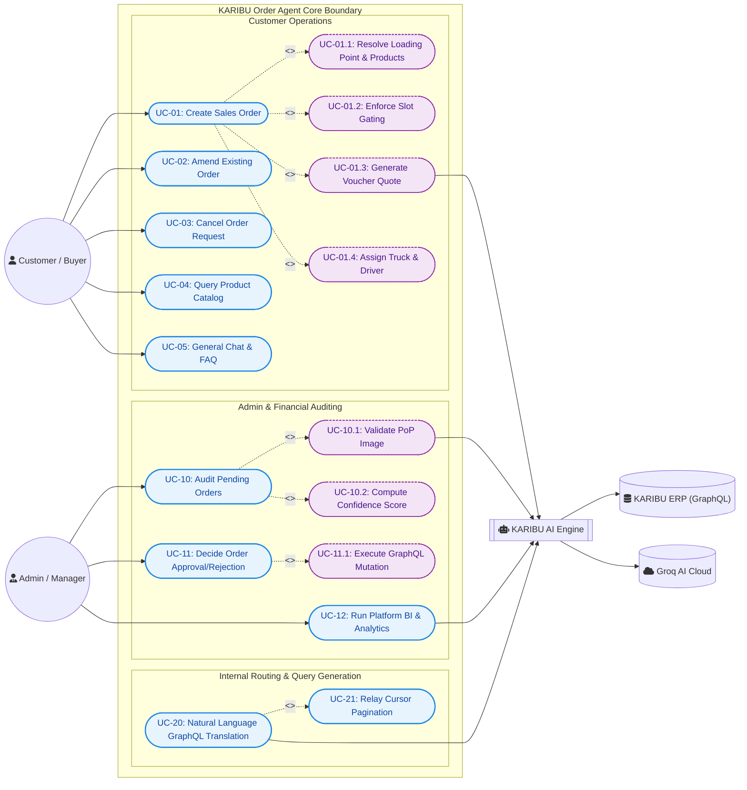
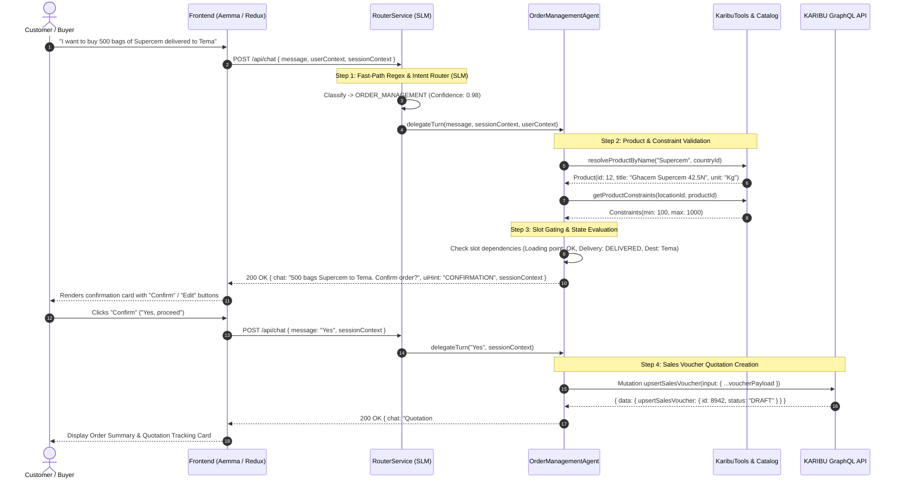
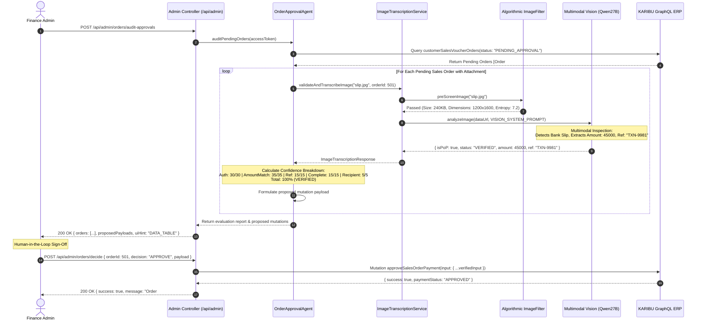
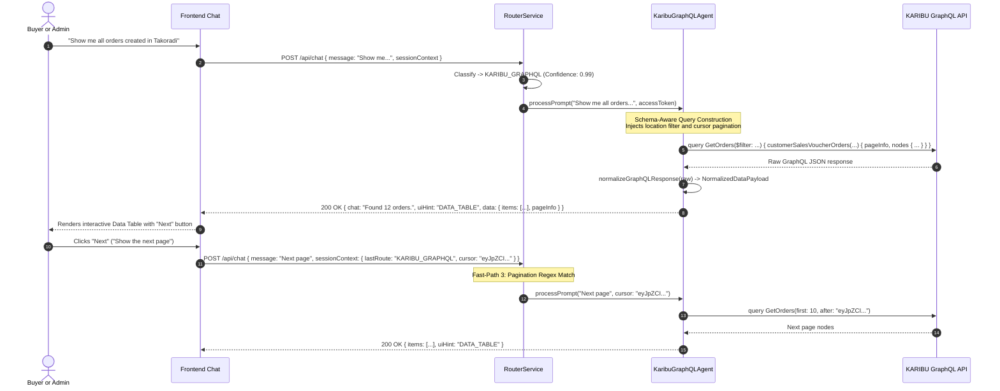

# KARIBU Order Agent Core — Comprehensive System Specification & Diagramming Guide

This document provides a comprehensive technical blueprint of the **KARIBU AI Engine (`order-agent-core`)**. It is structured specifically to serve as the definitive specification for generating:
1. **Use Case Diagrams** (actors, boundaries, associations, `<<include>>`, `<<extend>>`)
2. **Sequence Diagrams** (message flows, state transitions, client-server-agent lifecycles)
3. **System Architecture Diagrams** (layered topologies, network interfaces, components, databases)
4. **Multi-Model Interworking Diagrams** (SLM routing, multimodal vision, code generation, LLM synthesis, confidence scoring)

Mermaid diagrams and detailed structural notes are provided throughout.

---

## 1. Executive System Overview

The **KARIBU Order Agent Core** is a distributed, multi-model AI orchestration backend designed to automate and safeguard the end-to-end B2B/B2C sales order workflow for cement and industrial building materials.

```
                      +------------------------------------------+
                      |         Frontend Client (Aemma)          |
                      |   Redux Auth Store + Stateless Session   |
                      +--------------------+---------------------+
                                           |
                              HTTP / REST  | (JSON with uiHints)
                                           v
                      +------------------------------------------+
                      |      KARIBU AI Engine Core Gateway       |
                      |  Express API / Role Separation (Public)  |
                      +--------------------+---------------------+
                                           |
                                           v
                      +------------------------------------------+
                      |       Tier-1 Intent Router (SLM)         |
                      |    Fast Heuristics + Deterministic LLM   |
                      +----+-----------+-----------+-----------+-+
                           |           |           |           |
            +--------------+     +-----+-----+     |     +-----+--------------+
            v                    v           v     v     v                    v
+-----------------------+ +-------------+ +-----------+ +-----------------------+
| OrderManagementAgent  | | GraphQLAgent| |Analytics  | | OrderApprovalAgent    |
| Slot Gating & Voucher | | Query Gen   | | BI & Trends | +-----------+-----------+
+-----------+-----------+ +------+------+ +-----+-----+             |
            |                    |              |        +----------+----------+
            |                    |              |        v                     v
            |                    |              | +---------------+ +---------------+
            |                    |              | | ImageFilter   | | PaymentVision |
            |                    |              | | Algorithmic   | | Multimodal SLM|
            |                    |              | +---------------+ +---------------+
            v                    v              v
+-------------------------------------------------------------------------------+
|                      Target Infrastructure & Storage                           |
|       KARIBU GraphQL ERP API   |   Prisma ORM (SQLite Cache)   |   Groq Cloud |
+-------------------------------------------------------------------------------+
```

### Core Design Principles
* **Tiered / Routed AI Architecture**: Inbound natural language prompts pass through deterministic heuristics and a low-latency Small Language Model (SLM) router (`temperature: 0.0`) before reaching specialized domain agents.
* **Stateless Client-Driven Session**: Zero server-side session caches or Redis locks. The frontend maintains and echoes `sessionContext` (including `orderState` and `lastRoute`) on each turn, enabling seamless horizontal autoscaling.
* **Schema-Aware Safeguarding**: Natural language is never translated into arbitrary database commands. Queries and mutations are restricted to strict, typed GraphQL operations validated against the KARIBU schema.
* **Two-Tier Proof of Payment (PoP) Verification**: Uploaded bank slips and mobile money receipts pass through a CPU-bound algorithmic pre-screen (image format, dimensions, entropy) followed by a multimodal vision model (`qwen/qwen3.8-27b`).
* **Human-in-the-Loop Governance**: While the system automates transcription and calculates an objective multi-factor confidence score (0–100%), final order approval and ERP mutations strictly require explicit human administrator sign-off.

---

## 2. System Use Case Specification (Use Case Diagram Reference)

This section provides the actors, boundary definitions, use cases, and dependency mappings required to construct a standard UML Use Case Diagram.

### 2.1 Actors

| Actor | Category | Description | Access Scope |
| :--- | :--- | :--- | :--- |
| **Customer / Buyer** | Primary Human | Registered commercial or retail client purchasing cement or checking order status. | Public Endpoints (`/api/chat`, `/api/orders`, `/api/products`) |
| **Admin / Sales Manager** | Primary Human | Internal sales supervisor, logistics coordinator, or financial auditor. | Protected Endpoints (`/api/chat/admin`, `/api/admin/orders/*`, `/api/admin/payments/*`) |
| **KARIBU AI Engine** | Secondary System | Internal multi-agent orchestrator executing routing, slot gating, and synthesis. | Core System Boundary |
| **KARIBU GraphQL ERP** | Secondary External | Enterprise Resource Planning backend handling sales vouchers, stock, and ledger. | Upstream Service (`KARIBU_GRAPHQL_ENDPOINT`) |
| **Groq / AI Inference Cloud**| Secondary External | Serverless high-speed LLM and Vision inference provider. | External AI Infrastructure |
| **Local Prisma Cache** | Secondary Internal | SQLite-backed local repository mirroring country, location, and product catalogs. | Internal Persistence |

### 2.2 System Boundary & Use Cases

```
System Boundary: [KARIBU Order Agent Core]
```

#### A. Customer Order Intake & Self-Service
* **UC-01: Create Normal Sales Order**: Natural language conversational cart assembly for cement bags or bulk tonnage.
  * `<<include>>` **UC-01.1: Resolve Loading Point & Products**: Resolve plants or depots based on user permissions and availability.
  * `<<include>>` **UC-01.2: Validate Slot Gating**: Enforce company and location business rules (e.g., minimum order quantities, delivery types).
  * `<<include>>` **UC-01.3: Generate Sales Voucher Quote**: Request quote quotation via `upsertSalesVoucher` mutation.
  * `<<extend>>` **UC-01.4: Assign Truck & Driver**: Optional truck and driver assignment if permitted by company configuration.
* **UC-02: Amend Existing Order**: Update delivery dates or vehicle assignments on active orders.
* **UC-03: Cancel Order**: Submit a cancellation request for pending sales orders.
* **UC-04: Browse Product Catalog**: Query available cement types, item codes, and loading points.
* **UC-05: General Inquiry / FAQ**: Conversational assistance on operating hours, payment procedures, and portal usage.

#### B. Financial Audit & Order Approval (Admin)
* **UC-10: Audit Pending Orders**: Batch review of sales orders awaiting payment confirmation.
  * `<<include>>` **UC-10.1: Extract & Validate Proof of Payment (PoP)**: Algorithmic image pre-screening and multimodal transcription.
  * `<<include>>` **UC-10.2: Compute Approval Confidence Breakdown**: Score document authenticity, amount matching, reference format, and depositor data.
* **UC-11: Decide Order Approval / Rejection**: Human administrator triggers formal acceptance or rejection.
  * `<<include>>` **UC-11.1: Execute Payment GraphQL Mutation**: Invokes `approveSalesOrderPayment` or `rejectSalesOrderPayment`.
* **UC-12: Run Platform Business Intelligence (BI)**: Query real-time user activity, sales volume aggregations, order status distributions, and payment rejection reasons.

#### C. Autonomous Data Access & Schema Translation
* **UC-20: Natural Language GraphQL Querying**: Translate free-form questions into schema-validated GraphQL queries.
* **UC-21: Handle Cursor Pagination**: Support follow-up commands (e.g., "next page", "show 10 more") using Relay-compliant cursors.

### 2.3 Use Case Relationship Matrix

| Base Use Case | Dependency | Target Use Case | Condition / Rule |
| :--- | :--- | :--- | :--- |
| **UC-01 (Create Order)** | `<<include>>` | **UC-01.1 (Resolve Loading Point)** | Mandatory before product selection |
| **UC-01 (Create Order)** | `<<include>>` | **UC-01.2 (Slot Gating)** | Evaluated based on company flags (`loc`, `co`) |
| **UC-01 (Create Order)** | `<<include>>` | **UC-01.3 (Generate Quote)** | Explicit "Yes" confirmation received from user |
| **UC-01 (Create Order)** | `<<extend>>` | **UC-01.4 (Assign Logistics)** | If `truckSelectionAllowed` or `allowDriverSelection` is true |
| **UC-10 (Audit Pending)** | `<<include>>` | **UC-10.1 (Validate PoP)** | Only if sales order has an attached receipt document |
| **UC-10 (Audit Pending)** | `<<include>>` | **UC-10.2 (Compute Confidence)**| Triggered automatically upon receipt analysis |
| **UC-11 (Decide Approval)** | `<<include>>` | **UC-11.1 (Execute Mutation)** | Administrator submits decision payload |

### 2.4 Mermaid Use Case Diagram



---

## 3. Sequence Flows & Interaction Lifecycles (Sequence Diagram Reference)

This section details the message sequences, conditional loops, and validations across the system's key operational paths.

### 3.1 Flow 1: Conversational Order Placement (Customer)

#### Step-by-Step Description
1. **User Initiation**: The customer sends a natural language prompt (e.g., *"I need 500 bags of Supercem delivered to Tema"*). The client echoes its current `sessionContext` and user claims (`companyId`, `locationId`, `canCreateOrder`).
2. **Intent Routing**: The `RouterService` runs fast-path regex checks. It invokes the Intent Router (`ROUTER_MODEL`), returning route `ORDER_MANAGEMENT` with high confidence.
3. **Product & Constraint Resolution**: The `OrderManagementAgent` matches *"Supercem"* against the catalog and retrieves location constraints (`minProductQuantity`, `maxProductQuantity`).
4. **Slot Gating Engine**: The agent checks required configuration flags:
   * Loading point resolved? If multiple available, bot asks user.
   * Delivery type resolved? EXW (pickup) vs. DELIVERED.
   * Local Purchase Order (PO) required? Document upload required?
5. **Conversational Interactivity**: If slots are missing, the agent responds with a clarifying prompt and sets `uiHint: "PRODUCT_SELECTOR"` or `"CONFIRMATION"`.
6. **Order Confirmation & Quote Request**: Once all slots are satisfied and the customer provides explicit confirmation (*"Yes, submit"*), the agent builds and executes the `upsertSalesVoucher` GraphQL mutation.
7. **Client Feedback**: A standardized response is returned containing `uiHint: "ORDER_SUMMARY"`, the created voucher quote ID, and reset `sessionContext`.

#### Sequence Diagram (Mermaid)



---

### 3.2 Flow 2: Automated Proof of Payment (PoP) Verification & Admin Approval Flow

#### Step-by-Step Description
1. **Audit Initiation**: An administrator triggers a sales order audit via `POST /api/admin/orders/audit-approvals`.
2. **Fetch Pending Vouchers**: The `OrderApprovalAgent` queries GraphQL for orders with status `PENDING_PAYMENT_APPROVAL` and inspects attached payment slips.
3. **Tier-1 Algorithmic Filter**: `imageFilter.ts` validates file byte length, MIME type, dimensions, and visual entropy. Corrupted, truncated, or blank images are rejected instantly without incurring LLM cost.
4. **Tier-2 Multimodal Vision Audit**: `PaymentValidatorAgent` feeds the image data URL to `qwen/qwen3.8-27b` via Groq. The model outputs structured JSON with:
   * `isProofOfPayment: true | false`
   * `verificationStatus: "VERIFIED" | "SUSPICIOUS" | "REJECTED"`
   * Extracted fields: `amount`, `currency`, `transactionReference`, `bankOrPlatform`, `paymentDate`.
5. **Confidence Scoring Breakdown**: The agent computes an objective 5-part score out of 100:
   * **Authenticity (30 pts)**: Multimodal confidence and anti-tamper check.
   * **Amount Match (35 pts)**: Extracted amount vs. ERP order quote.
   * **Reference Validity (15 pts)**: Unique, non-duplicated slip/transaction ID format.
   * **Transcription Completeness (15 pts)**: Date, bank ID, depositor name presence.
   * **Recipient Consistency (5 pts)**: Paid to the authorized corporate account.
6. **Proposed Mutation Assembly**: The agent builds the exact GraphQL mutation (`approveSalesOrderPayment`) with pre-filled transcription variables.
7. **Human Decision Sign-off**: The administrator reviews the audit breakdown on their dashboard and posts an explicit decision (`/api/admin/orders/decide`). The server executes the mutation and returns confirmation.

#### Sequence Diagram (Mermaid)



---

### 3.3 Flow 3: Natural Language GraphQL Query & Pagination Flow



---

## 4. System Architecture Specification (Architecture Diagram Reference)

The system is organized into a clean, layered architecture separating presentation, orchestration, domain reasoning, and data layers.

```
+---------------------------------------------------------------------------------------+
|                                1. CLIENT / PRESENTATION LAYER                         |
|  - Aemma Frontend (React 19 / Next.js)       - Redux Auth Store (User Context)        |
|  - Dynamic UI Hint Renderers:                                                         |
|    [PRODUCT_SELECTOR] [ORDER_SUMMARY] [CONFIRMATION] [DATA_TABLE] [RECEIPT_UPLOAD]     |
+-------------------------------------------+-------------------------------------------+
                                            | HTTPS / JSON
                                            v
+---------------------------------------------------------------------------------------+
|                                2. API GATEWAY & ROUTING INGRESS                       |
|  - Express Application (server.ts / app.ts)                                           |
|  - Public Routes: /api/chat, /api/orders, /api/products, /api/route                   |
|  - Admin Routes:  /api/chat/admin, /api/admin/orders/*, /api/admin/payments/*         |
|  - Fast-Path Regex Guard (Topic switching, pagination detection, confirmation checks) |
+-------------------------------------------+-------------------------------------------+
                                            |
                                            v
+---------------------------------------------------------------------------------------+
|                             3. TIER-1 INTENT ORCHESTRATOR                             |
|  - RouterService.ts: Deterministic Intent Classifier (temperature: 0.0)               |
|  - Default Routing Model: Qwen2.5-1.5B-Instruct / gpt-oss-20b via Groq Cloud         |
|  - Routes: ORDER_MANAGEMENT | KARIBU_GRAPHQL | ANALYTICS | GENERAL_CHAT | UNKNOWN     |
+----+---------------------+--------------------+--------------------+--------------+
     |                     |                    |                    |
     v                     v                    v                    v
+------------------+ +------------------+ +------------------+ +------------------------+
| 4A. ORDER AGENT  | | 4B. GRAPHQL AGENT| | 4C. ANALYTICS    | | 4D. GENERAL CHAT AGENT |
| - Slot Gating    | | - Prompt-to-GQL  | |   AGENT          | - Chit-chat & FAQs       |
| - State Machine  | | - AST Validation | | - BI Aggregations| - Graceful Fallback      |
| - Quote Creator  | | - Cursor Paging  | | - Rejection Stats| - Context Window Pruning |
+------------------+ +------------------+ +------------------+ +------------------------+
                           ^
                           |
+--------------------------+----------------------------+
| 4E. FINANCIAL AUDIT & VERIFICATION MATRIX             |
|  - OrderApprovalAgent: Confidence Scoring (0-100%)    |
|  - PaymentValidatorAgent: Two-tier evaluation         |
|  - ImageFilter: CPU-bound image sanity verification   |
|  - Vision Model: Multimodal Qwen3.8-27b on Groq       |
+-------------------------------------------------------+
                           |
                           v
+---------------------------------------------------------------------------------------+
|                              5. PERSISTENCE & INTEGRATION LAYER                       |
|  - KARIBU Remote GraphQL ERP: Source of truth for production vouchers, stock, prices  |
|  - Prisma ORM & Local SQLite DB (dev.db): Cached catalog, country & customer profiles |
|  - File System: Temporary proof-of-payment image attachments (test-images/, uploads)  |
|  - Groq Cloud API: High-speed serverless inference endpoints                          |
+---------------------------------------------------------------------------------------+
```

### 4.1 Layer Responsibilities & Interfaces

#### Layer 1: Client / Presentation Layer
* **Role**: Runs on the user's browser or mobile device. Ingests user identity and permissions from Redux (`user.companyId`, `user.customerId`, `canCreateOrder`) and injects them into the request body.
* **Stateless Continuity**: Echoes the `sessionContext` JSON object containing `lastRoute`, `lastUserPrompt`, `conversationId`, and partial `orderState`.
* **Component Factory (`uiHint`)**: Renders specialized interface components based on the backend's returned `uiHint`:
  * `"PRODUCT_SELECTOR"`: Renders interactive product cards (bags/bulk tonnage).
  * `"ORDER_SUMMARY"`: Displays pre-submission quote details.
  * `"CONFIRMATION"`: Displays binary action buttons ("Yes, Confirm", "Cancel").
  * `"DATA_TABLE"`: Renders responsive paginated tables consuming `NormalizedDataPayload`.
  * `"RECEIPT_UPLOAD"`: Renders a drag-and-drop file uploader for Proof of Payment.

#### Layer 2: API Gateway & Ingress Layer
* **Role**: Validates HTTP payloads, enforces CORS and authentication tokens, and provides role-based separation:
  * Customer endpoints handle ordering and standard catalog lookups.
  * Admin endpoints require manager credentials to access financial audits, image transcription, and platform analytics.
* **Fast-Path Regex Guards**: Intercepts high-frequency deterministic phrases before invoking an LLM:
  * Questions (`"how many..."`, `"what is..."`) instantly bypass order-step locks.
  * Confirmations (`"yes"`, `"confirm"`, `"proceed"`) stay in active order workflows.
  * Continuation commands (`"next page"`, `"show 5 more"`) preserve GraphQL cursor states.

#### Layer 3: Tier-1 Intent Orchestrator
* **Role**: Natural language intent router running at `temperature: 0.0`.
* **Output**: Strict JSON schema:
  ```json
  {
    "route": "ORDER_MANAGEMENT" | "KARIBU_GRAPHQL" | "ANALYTICS" | "GENERAL_CHAT" | "UNKNOWN",
    "confidence": 0.98,
    "reason": "Classified based on intent to purchase cement"
  }
  ```

#### Layer 4: Specialized Domain Agent Matrix
* **`OrderManagementAgent`**: Stateful multi-turn slot filler enforcing business configuration flags (e.g., depot vs. plant collection, delivery inclusion, minimum truckload rules).
* **`KaribuGraphQLAgent`**: Converts natural language requests into valid GraphQL queries or mutations without exposing raw database structures or leaking internal identifiers.
* **`AnalyticsAgent`**: High-frequency business intelligence agent querying users, order volumes, conversion rates, and rejection trends.
* **`OrderApprovalAgent`**: Orchestrates image pre-screening, vision models, and confidence scoring.
* **`GeneralChatAgent`**: Handles greetings, platform inquiries, and out-of-scope queries with conversational friendliness.

#### Layer 5: Persistence & Integration Layer
* **KARIBU GraphQL Endpoint**: Primary enterprise core for sales vouchers, ledger updates, customer balances, and order confirmations.
* **Prisma ORM & SQLite**: Mirror database containing offline schemas, mock test data, and cached catalog entries.
* **Groq SDK / Inference Cloud**: High-throughput serverless provider running open-weights models (`Qwen2.5-1.5B`, `Qwen3.8-27b Vision`, `gpt-oss-20b`).

---

## 5. Multi-Model Interworking & AI Pipeline

A critical architectural highlight of the KARIBU AI Engine is its **collaborative multi-model topology**. Instead of relying on a single, expensive frontier LLM, the system routes tasks across small, specialized models optimized for latency, cost, and task suitability.

```
                           +---------------------------+
                           |  Inbound Natural Language |
                           +-------------+-------------+
                                         |
                                         v
+---------------------------------------------------------------------------------+
| Fast-Path Regex Heuristic Guard (Bypasses LLM for standard commands)             |
+----------------------------------------+----------------------------------------+
                                         | Cache Miss / Ambiguous
                                         v
+---------------------------------------------------------------------------------+
| MODEL 1: Fast Intent Router SLM                                                 |
| Model: Qwen2.5-1.5B-Instruct / gpt-oss-20b  |  Latency: <200ms  |  Temp: 0.0    |
| Task: Deterministic classification -> JSON payload { route, confidence, reason } |
+----+---------------------+--------------------+--------------------+------------+
     |                     |                    |                    |
     | [ORDER_MANAGEMENT]  | [KARIBU_GRAPHQL]   | [ANALYTICS]        | [GENERAL]
     v                     v                    v                    v
+-----------------+ +-----------------+ +-----------------+ +---------------------+
| MODEL 3A:       | | MODEL 3B:       | | MODEL 4:        | | MODEL 5:            |
| Domain Slot     | | GraphQL Syntax  | | BI Synthesis    | | Conversational Chat |
| Specialist      | | Generator       | | Model           | | Model               |
| Temp: 0.1       | | Temp: 0.0       | | Temp: 0.1       | | Temp: 0.7           |
| Enforces config | | Schema-aware    | | Aggregations,   | | Warm conversational |
| rules & slots   | | query mapping   | | metric summaries| | fallback & FAQ      |
+--------+--------+ +--------+--------+ +--------+--------+ +----------+----------+
         |                   |                   |                     |
         +-------------------+---------+---------+---------------------+
                                       |
                                       v
                     +-----------------------------------+
                     |   Normalized Data Payload Engine   |
                     |   Attaches UI Hint & Suggestions  |
                     +-----------------+-----------------+
                                       |
                                       v
                     +-----------------------------------+
                     |       Unified HTTP Response       |
                     +-----------------------------------+

     +--------------------------------------------------------------------+
     | SEPARATE MULTIMODAL AUDIT PIPELINE (Triggered on Receipts)         |
     |                                                                    |
     | 1. ImageFilter.ts: Algorithmic Pre-Screen (Entropy/Size/Format)   |
     |                     | (Passes)                                     |
     |                     v                                              |
     | 2. MODEL 2: Multimodal Vision SLM (qwen/qwen3.8-27b on Groq)       |
     |    Task: Receipt authenticity, tamper detection, field extraction |
     |                     |                                              |
     |                     v                                              |
     | 3. OrderApprovalAgent: Deterministic 5-part Confidence Scoring    |
     |                     |                                              |
     |                     v                                              |
     | 4. Proposes Pre-filled Mutation for Human-in-the-Loop Sign-off     |
     +--------------------------------------------------------------------+
```

### 5.1 Model Inventory & Specialization Matrix

| Component | Target Model | Hosted Provider | Temperature | Latency Profile | Primary Duty |
| :--- | :--- | :--- | :--- | :--- | :--- |
| **Model 1: Intent Router** | `Qwen2.5-1.5B-Instruct` or `gpt-oss-20b` | Groq / HuggingFace Serverless | `0.0` | Ultra-fast (~150ms) | Classify inbound intent into strict JSON enum without conversational filler. |
| **Model 2: Multimodal Vision** | `qwen/qwen3.8-27b` (Vision) | Groq Cloud Serverless | `0.1` | Moderate (~900ms) | Inspect uploaded receipts for fraud, classify document type, extract transaction data. |
| **Model 3A: Slot Specialist** | `openai/gpt-oss-20b` | Groq Cloud Serverless | `0.1` | Fast (~350ms) | Map conversational buyer answers to typed slot schemas and configuration rules. |
| **Model 3B: GraphQL Generator** | `openai/gpt-oss-20b` | Groq Cloud Serverless | `0.0` | Fast (~300ms) | Convert natural language questions into safe, valid GraphQL queries with Relay cursors. |
| **Model 4: BI Analytics Model** | `openai/gpt-oss-20b` | Groq Cloud Serverless | `0.1` | Fast (~400ms) | Formulate metric queries, execute aggregations, and generate executive summaries. |
| **Model 5: Conversational Model**| `openai/gpt-oss-20b` | Groq Cloud Serverless | `0.7` | Fast (~300ms) | Friendly chit-chat, customer guidance, and helpful error explanations. |

### 5.2 Interworking & Hand-Off Mechanics

1. **Gatekeeping & Cost Optimization**: Inbound requests never go directly to expensive vision models or high-parameter LLMs. The fast regex gate intercepts standard patterns, and the lightweight router (`Model 1`) directs the payload to the appropriate specialized agent.
2. **Vision Separation**: Image verification is decoupled from text chat. When an order with an attachment is audited:
   * `imageFilter.ts` runs locally on the CPU (validating file headers and image clarity).
   * Only valid images reach the multimodal model (`Model 2`).
   * The extracted data feeds into the confidence scoring engine, which formats the proposed GraphQL mutation.
3. **Deterministic Output Guarantees**: All generative models interfacing with APIs or databases use `response_format: { type: "json_object" }` and `temperature: 0.0`. This prevents markdown contamination or hallucinated fields from reaching the ERP.
4. **Context Window Protection**: The general chat agent maintains a rolling window of the last 10 turns, preventing context overflow while preserving conversational flow.

---

## 6. Data Contracts & State Machine Reference

### 6.1 Chat Request Contract (`POST /api/chat`)

```typescript
export interface FrontendChatRequest {
  message: string;
  userContext?: {
    userId?: string;
    customerId?: number | string;
    companyId?: string;
    countryId?: number;
    locationId?: string;
    canCreateOrder?: boolean;
  };
  sessionContext?: {
    lastRoute?: "ORDER_MANAGEMENT" | "KARIBU_GRAPHQL" | "ANALYTICS" | "GENERAL_CHAT" | "UNKNOWN";
    lastUserPrompt?: string | null;
    conversationId?: string;
    orderState?: {
      loadingPointId?: number;
      deliveryType?: "EXW" | "DELIVERED";
      destinationId?: number;
      localPurchaseOrder?: string;
      items?: Array<{
        productId: number;
        quantity: number;
        trucksCount: number;
      }>;
    };
  };
  accessToken?: string;
}
```

### 6.2 Chat Response Contract

```typescript
export interface FrontendChatResponse<T = NormalizedDataPayload> {
  success: boolean;
  responseType: "ORDER_MANAGEMENT" | "KARIBU_GRAPHQL" | "ANALYTICS" | "GENERAL_CHAT" | "UNKNOWN";
  chat: string;
  data: NormalizedDataPayload<T> | null;
  uiHint: "TEXT" | "PRODUCT_SELECTOR" | "ORDER_SUMMARY" | "CONFIRMATION" | "DATA_TABLE" | "DATA_POINTS" | "RECEIPT_UPLOAD";
  suggestions: string[];
  sessionContext: ChatSessionContext;
  debug?: {
    route: string;
    confidence: number;
    latencyMs: number;
    reason: string;
  };
}
```

### 6.3 Proof of Payment Confidence Formula

$$\text{Total Confidence Score} = S_{\text{auth}} + S_{\text{amount}} + S_{\text{ref}} + S_{\text{complete}} + S_{\text{recipient}}$$

| Parameter | Max Points | Evaluation Criteria |
| :--- | :--- | :--- |
| **$S_{\text{auth}}$ (Authenticity)** | **30** | Algorithmic pre-screen passed (10 pts) + Multimodal vision authenticity score $\ge 0.85$ without tamper flags (20 pts). |
| **$S_{\text{amount}}$ (Amount Match)** | **35** | Extracted numerical amount matches the sales order quote within $\pm 0.50$ currency tolerance. |
| **$S_{\text{ref}}$ (Reference Validity)** | **15** | Valid slip reference / mobile money transaction ID format (e.g., length $\ge 6$ chars, non-empty, unique in database). |
| **$S_{\text{complete}}$ (Transcription)** | **15** | Mandatory fields present: valid date (5 pts), bank/platform identification (5 pts), depositor name/contact (5 pts). |
| **$S_{\text{recipient}}$ (Recipient Match)** | **5** | Paid to authorized corporate bank account (e.g., Heidelberg Materials / Ghacem Ltd). |
| **Total Available** | **100** | $\ge 80$: **High Confidence** (Proposed for single-click approval)<br>$60 - 79$: **Moderate** (Requires inspection)<br>$< 60$: **Low / Suspicious** (Flagged for rejection) |

---

## 7. Diagramming Quick Reference Sheet

Use this cheat sheet to quickly map system concepts into UML diagram tools (Lucidchart, PlantUML, Draw.io, Mermaid):

* **Use Case Diagram**:
  * Actors: `Customer`, `Admin`, `KARIBU AI Engine`, `KARIBU GraphQL ERP`, `Groq Cloud`.
  * Groupings: Customer Orders (UC-01 to UC-05), Financial Auditing (UC-10 to UC-12), Core Translation (UC-20 to UC-21).
  * Key relationship: Customer creates order $\rightarrow$ includes slot gating, product resolution, and quotation request.
* **Sequence Diagram**:
  * Participants: `Client/Redux`, `RouterService`, `OrderManagementAgent`, `ApprovalAgent`, `PaymentVision`, `GraphQL ERP`.
  * Key loops: Multi-turn slot filling loop for missing order information; batch loop for auditing pending order receipts.
* **Architecture Diagram**:
  * 5 Layers: Client Presentation $\rightarrow$ Gateway Ingress $\rightarrow$ Tier-1 Router $\rightarrow$ Agent Matrix $\rightarrow$ Persistence & External Services.
  * Security boundary: Split between Public Customer routes and Protected Admin routes.
* **Model Interworking Diagram**:
  * Two parallel tracks: High-speed conversational loop (`Model 1` Router $\rightarrow$ `Model 3` Generators) and the Asynchronous Audit track (`ImageFilter` $\rightarrow$ `Model 2` Vision $\rightarrow$ Confidence Scorer $\rightarrow$ Human Sign-off).
